<p align="center">
  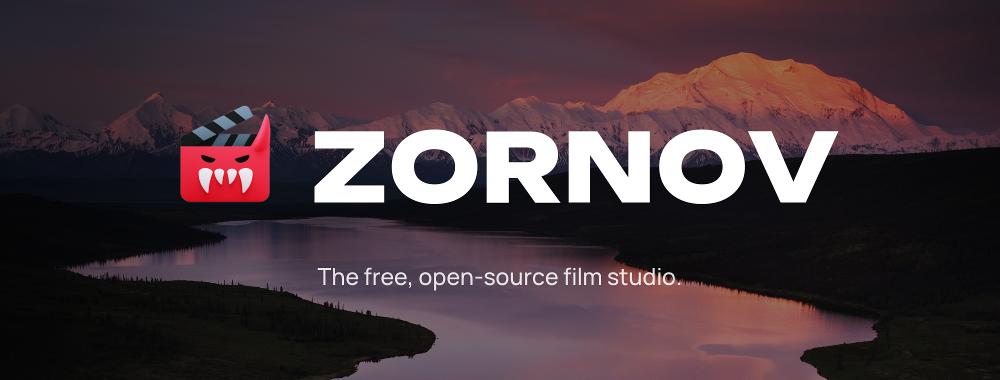
</p>

<p align="center">
  <a href="LICENSE"></a>
  <a href="LICENSING.md"></a>
  
  
</p>

<p align="center">
  <a href="https://zornov.com/download"><b>Download</b></a> ·
  <a href="https://zornov.com">Website</a> ·
  <a href="#made-in-zornov">Films</a> ·
  <a href="#the-ai-editor">AI editor</a> ·
  <a href="#with-your-ai-assistant">MCP</a> ·
  <a href="#what-it-does">Features</a> ·
  <a href="#build-and-run">Build</a> ·
  <a href="#documentation">Docs</a>
</p>

<br>

<p align="center">
  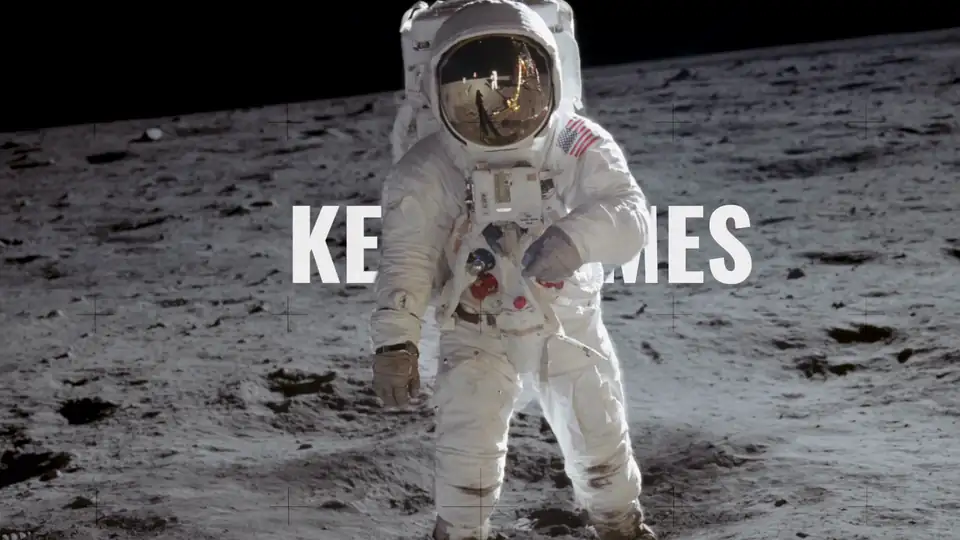
  <br>
  <sub>1,344 keyframes in one edit, made in Zornov.</sub>
</p>

Zornov™ is a free, open-source film studio. Edit, grade, animate puppets, build 3D worlds, compose the score and deliver, all in one app. An AI director can work on the same timeline while you do, and you can take over anywhere.

Every tool the window has is also one call away for AI assistants. Claude, Codex or any client that speaks MCP can open a project, cut it, light it, score it, look at the frames, check its own work and export, with the same tools you use.

## Made in Zornov

Every film here was edited, animated, scored and exported in Zornov, from public-domain footage or from scratch.

<table>
  <tr>
    <td width="50%">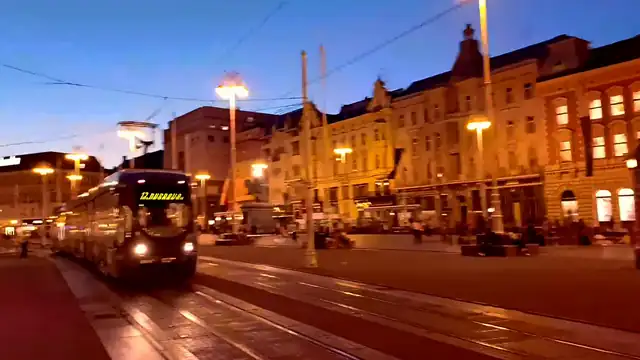</td>
    <td width="50%">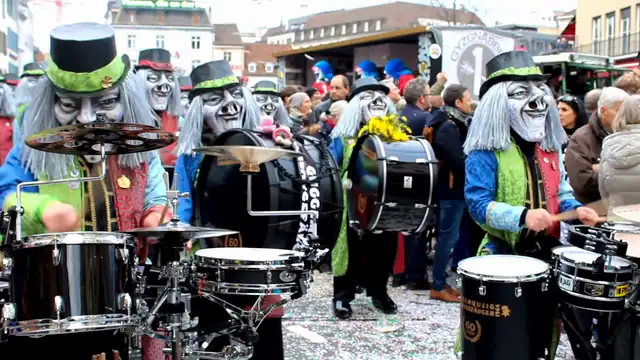</td>
  </tr>
  <tr>
    <td align="center"><sub><b>Edit</b>: city nights, cut on the beat</sub></td>
    <td align="center"><sub><b>Sound</b>: music composed in the app, every cut on a beat</sub></td>
  </tr>
  <tr>
    <td>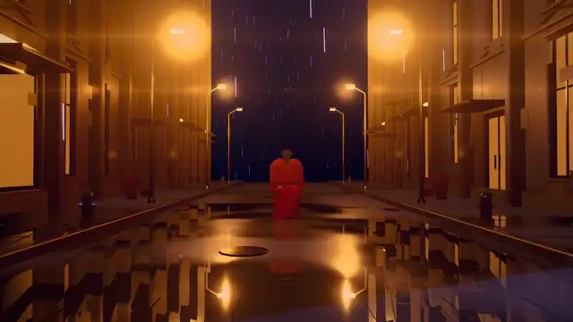</td>
    <td>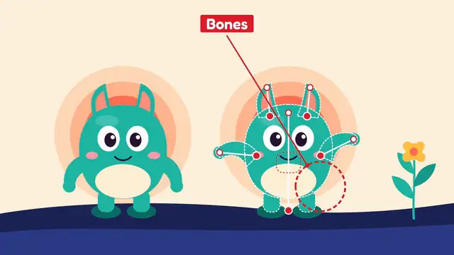</td>
  </tr>
  <tr>
    <td align="center"><sub><b>3D</b>: a rainy street, rendered in Zornov</sub></td>
    <td align="center"><sub><b>Puppets</b>: every puppet tool, labelled as it works</sub></td>
  </tr>
  <tr>
    <td>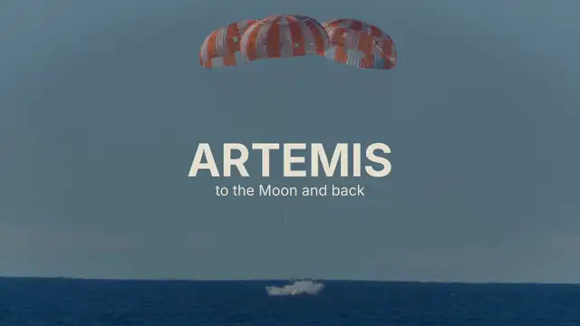</td>
    <td>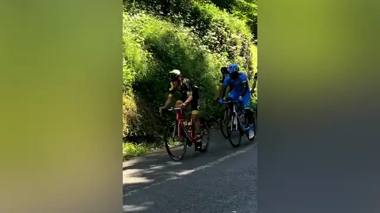</td>
  </tr>
  <tr>
    <td align="center"><sub><b>AI director</b>: a mission trailer, cut by AI through Zornov's tools</sub></td>
    <td align="center"><sub><b>Deliver</b>: one film, tall and wide</sub></td>
  </tr>
  <tr>
    <td colspan="2">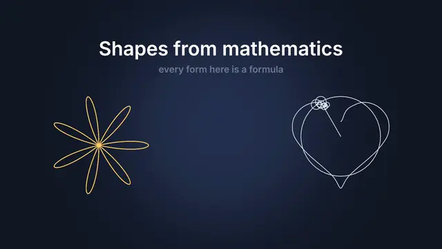</td>
  </tr>
  <tr>
    <td colspan="2" align="center"><sub><b>Shapes from mathematics</b>: every form is a formula, meshed or traced straight from it, made by an AI assistant through MCP</sub></td>
  </tr>
</table>

### Models made in Zornov

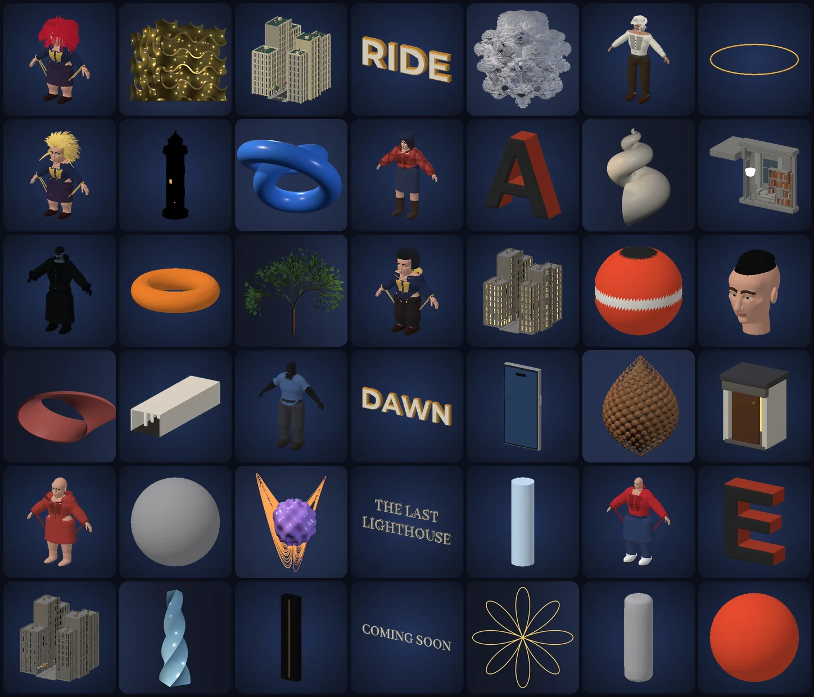

<sub>Every one modelled, dressed or grown in Zornov, many by an AI assistant driving its tools through MCP.</sub>

## The editor

<picture>
  <source media="(prefers-color-scheme: dark)" srcset="docs/images/editor-dark.png">
  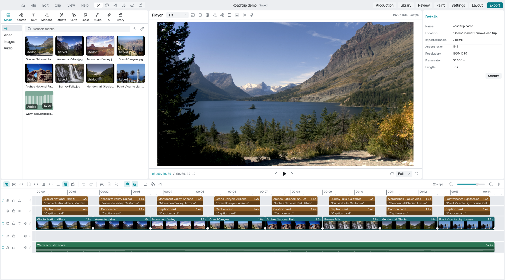
</picture>

## The AI editor

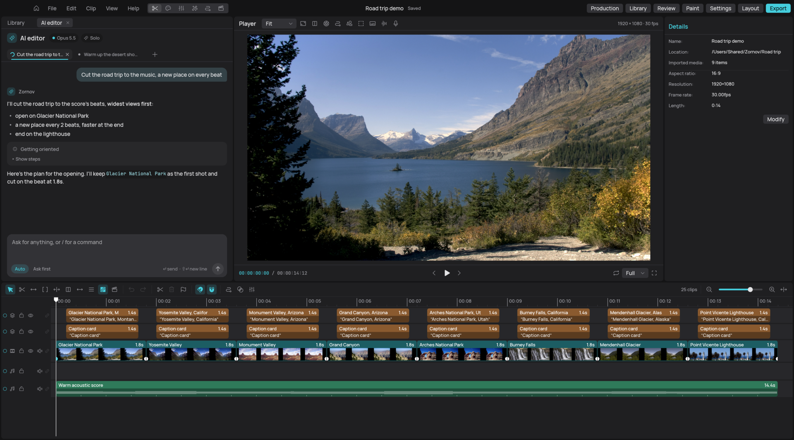

Tell it what you want, and it works on your timeline live, with more than 80 tools: it can see, listen, cut, model, animate, light, score, check and export.

- **Crew mode** splits a film across an Editor, Animator, Sound designer, VFX artist and Colourist working in parallel.
- **Plans you can follow.** Bigger jobs start with a plan. You approve checkpoints, correct it mid-flight, or stop it.
- **Your edits and its edits never collide**, and each side has its own undo.
- **Skills and lessons.** It loads how-to packs for each kind of work and learns from your corrections. You can edit or delete what it learned in Settings.
- **Checks before export:** overlaps, titles over faces, flat lighting, floating objects, sliding feet, bad lip sync and more, each with the exact fix.
- **Real media first.** It looks in your library before it generates anything.
- **Careful with outside content.** Web pages, transcripts and shared notes are treated as material, never as instructions, and anything that sends data out or spends money asks you first.

The AI editor uses the model you connect: Codex with your ChatGPT sign-in, Claude Code, or an API key. What you ask it, and what it looks at to answer, goes to that provider. The rest of Zornov works without it, and offline.

## With your AI assistant

`zornov mcp` serves every tool to an AI assistant over the Model Context Protocol. If the project is open in a Zornov window, you watch each edit land as the assistant makes it.

| Assistant | Set it up |
|---|---|
| **Claude Code** | `/plugin marketplace add zornov/zornov`, then `/plugin install zornov@zornov` |
| **Claude Desktop** | Open [`Zornov.mcpb`](https://github.com/zornov/zornov/releases/latest/download/Zornov.mcpb) from the latest release |
| **Codex** | `codex mcp add zornov -- zornov mcp --project /path/to/my-video` |
| **Any MCP client** | `{"command": "zornov", "args": ["mcp", "--project", "/path/to/my-video"]}` |

The assistant gets the whole studio, not a render API: `edit` takes ops in one undoable step, `see` and `contact_sheet` show it the frames, `listen` lets it hear the mix, and `check`, `review` and `qc` tell it what a professional wouldn't ship before it exports. Leave out `--project` and it opens or starts a project itself. On Windows, use `zornov-cli.exe`. See [AI assistants (MCP)](docs/terminal.md#ai-assistants-mcp) for every setup.

## What it does

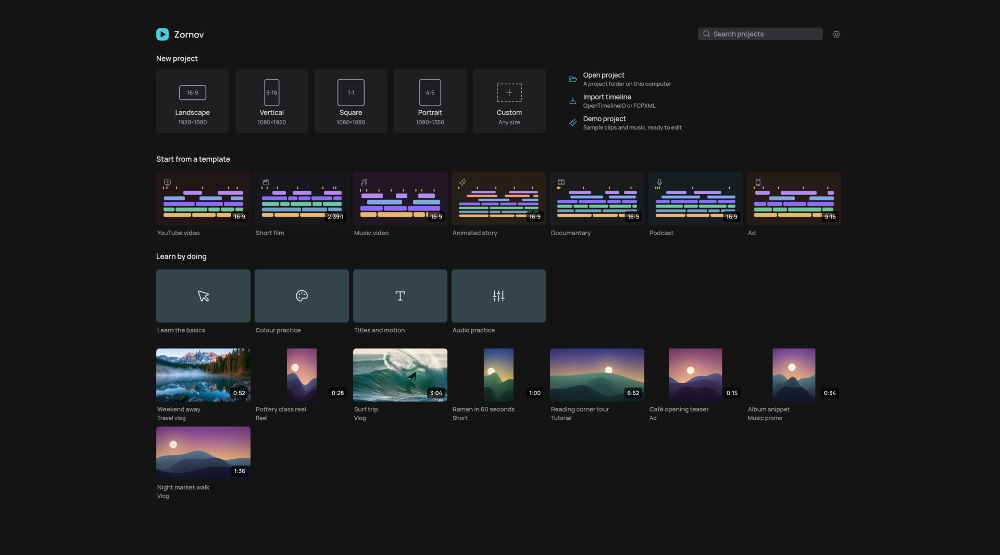

### Edit
- A magnetic timeline with lanes, markers, groups, nesting, ripple, roll, slip and slide.
- Source/record editing, J and L cuts, three-point edits, takes and string-outs.
- Keyframes and curves, speed ramps, time remapping, freeze frames and reverse.
- Titles, lower thirds, callouts, charts and 3D text, edited in place on the canvas.

### Picture
- Its own codecs, written in Rust. It reads H.264, HEVC, AV1, VP9, ProRes, AAC, Opus, Vorbis, FLAC and MP3 from MP4, MOV, WebM and MKV, and writes H.264, ProRes, DNxHR and AAC. HEVC 10-bit goes through the Mac's hardware encoder.
- Masters as EXR and DPX sequences, and MXF track files for DCP and IMF packages.
- A GPU compositor working in 16-bit float, with blend modes, masks, mattes, tracking, stabilising and corner pinning.
- Colour grading with scopes, LUTs, HDR and shot matching.
- Keying, rotoscoping and cut-outs. Restore, denoise, upscale and smooth slow motion.

### 3D
- A full modelling workspace: extrude, inset, bevel, loop cut, knife and bridge, modifiers, UVs, materials and sculpting.
- Characters with fingers, eyes, lashes and teeth, sculpted hairstyles that sit under a hat, and closed clothes that move with the skin, with fabric patterns at their real size. Rigs, and walks with planted feet.
- Shapes from mathematics: lattices like the gyroid, fractals like the Mandelbulb and Menger sponge, parametric surfaces, knots, height fields, L-system plants, phyllotaxis and strange attractors, or any formula of x, y, z and time. Twist, bend, taper and warp any model. Fractals and implicit solids can be traced straight from their formula on the GPU, with no mesh.
- Toon and anime looks: cel bands, shadow colour, rim light and ink outlines on any model, and anime proportions for characters.
- Physics: rigid bodies, ragdolls, cloth, hair, fracture, fluids and smoke, baked to the timeline.
- A real-time renderer and a path tracer with weather, fog, light beams and wet surfaces.
- Walkable worlds with terrain, plants, water and sky, recorded as camera shots. Procedural streets and interiors in eight styles.
- glTF, OBJ, FBX, STL, PLY and USD import (USD as text: .usda, or a .usdz holding a text layer; binary .usdc is not read). Export to glTF, USD (.usdz and .usda), FBX, OBJ, STL and PLY.

### Animation
- Puppets with pins, bones and scissor cuts, so limbs and lips move apart. They walk, run and sneak, each foot planted on the ground and lifted in an arc.
- Lip sync, blinks, acting beats, drivers and squash and stretch.
- Motion presets, stagger, expressions and particles.
- Vector illustration with paths, pathfinder, type and trace.

### Sound
- A mixer with buses, loudness, stems, dialogue cleanup and ADR, and an effects chain on every clip.
- Original music composed in the app in 18 genres, from jazz and folk to metal, trap, drum and bass, synthwave and chiptune, fitted to the exact length and cue points. It plays 29 instruments, distorted guitars with power chords among them, and says so when the brief asks for something it can't make.
- More than 50 physically modelled sound effects, 16 animal voices, footsteps on 14 surfaces, and sung vocals.
- Narration with the system's voices, or ElevenLabs and Fish Audio if you add their keys.

## Download

Get Zornov for macOS, Windows or Linux from **[zornov.com/download](https://zornov.com/download)**. It updates itself from inside the app.

## Build and run

Zornov is written in Rust (edition 2024). Each system builds natively, and each one packages and starts a little differently.

### macOS and Linux

```bash
cargo build --release -p studio-app
./target/release/zornov
```

One `zornov` program does both: started from Finder, the Dock or a desktop entry it opens the editor, and in a terminal it gives the prompt.

| Package | Command | Makes |
|---|---|---|
| macOS app | `cargo xtask bundle` | `dist/Zornov.app` |
| macOS DMG, signed and notarised | `cargo xtask release-mac` | see [`docs/releasing.md`](docs/releasing.md) |
| Linux portable | `cargo xtask package-linux` | `dist/zornov-linux-<arch>.tar.gz` |
| Linux packages | `cargo xtask package-deb`, `package-appimage` | `dist/release/` |

### Windows

From Command Prompt:

```cmd
git clone https://github.com/zornov/zornov.git
cd zornov
cargo build --release -p studio-app
target\release\zornov.exe
```

You need Rust with the MSVC toolchain and the Windows SDK. The build copies DXC, Microsoft's DirectX shader compiler, from the SDK next to `zornov.exe`, and Zornov draws through DirectX 12 with it, because Vulkan crashes on some Intel graphics drivers.

Windows ships **two programs** side by side: `zornov.exe` opens the editor (double click, Start menu), and `zornov-cli.exe` is for the terminal, so use `zornov-cli` wherever these docs say `zornov` in a terminal.

| Package | Command | Makes |
|---|---|---|
| Portable zip | `cargo xtask package-windows` | `dist\zornov-windows-x64.zip` |
| Installer | `cargo xtask package-msi` (needs WiX 5) | `dist\release\Zornov-<version>-windows-x64.msi` |

The last crate (the app itself) takes a long time to optimise, so the build can sit at `628/629` for a while. The build needs files with LF line endings, as committed; `.gitattributes` makes Git for Windows keep them. See [Windows](docs/windows.md) for what you need, fixing an older CRLF checkout, the two programs, graphics, and signing.

See [`docs/releasing.md`](docs/releasing.md) for signing, notarisation and the update feed on every system.

<details>
<summary><b>Linux in a container</b></summary>

<br>

To build and test the Linux version without installing anything else, use the container in [`docker/Dockerfile`](docker/Dockerfile). Open the repository in VS Code or GitHub Codespaces and choose **Reopen in Container**, or run:

```bash
docker build -t zornov-linux docker
docker run --rm -it -v "$PWD:/work" zornov-linux cargo test --workspace
```

The container has a software graphics driver, so the GPU tests run without a graphics card. It can also check that the Windows code compiles; see [`CONTRIBUTING.md`](CONTRIBUTING.md).

</details>

## From the terminal

Everything the window does also works from a terminal, or with no window at all, for scripts, render machines and AI assistants. Every film above was made this way.

```bash
zornov new my-video && cd my-video
zornov card colour=red at=0 duration=2
zornov text "Hello" at=0.5
zornov check
zornov export out.mp4
```

Run `zornov` on its own for a prompt: commands run, anything else goes to the AI editor. `zornov agent --headless` speaks JSON for scripts, and `zornov mcp` serves the tools to any AI assistant that speaks MCP. On Windows, type `zornov-cli` instead of `zornov`. See [Terminal and headless use](docs/terminal.md).

## Documentation

| Guide | What it covers |
|---|---|
| [AI crew](docs/ai-crew.md) | How the AI editor and its crew work |
| [Terminal and headless use](docs/terminal.md) | The `zornov` prompt, one-off commands, JSON for scripts, MCP for Claude Code, Claude Desktop, Codex and others, and render nodes |
| [Seeing what agents go through](docs/agent-observability.md) | For Zornov's developers: the flight recorder, friction reports, replay, and the dev-only live tap |
| [Plugins](docs/plugins.md) | Writing plugins: effects, generators, transitions, importers, exporters and panels |
| [Accessibility](docs/accessibility.md) | Using Zornov without a mouse, with a screen reader, at large sizes and in any light |
| [Localisation](docs/localisation.md) | The interface languages and how to add translations |
| [Onboarding, help and workspaces](docs/onboarding-help-workspaces.md) | First run, built-in help and layouts |
| [Accounts and cloud](docs/accounts-and-cloud.md) | Optional accounts, credits, the cloud and the marketplace (off by default) |
| [Models](docs/models.md) | The AI models Zornov can download when you ask, and their licences |
| [Automation security](docs/automation-security.md) | How issues, pull requests and automation are kept safe |
| [Releasing](docs/releasing.md) | Signing, notarisation, release packages and updates |
| [Windows](docs/windows.md) | Building, running and packaging on Windows: LF line endings, the window and terminal programs, the zip and the installer |

<details>
<summary><b>Repository layout</b></summary>

<br>

The app is in [`app/`](app): the interface, the editor, the 3D workspace and the AI editor. Its engines are libraries in `crates/`, grouped by what they do:

| Folder | What it holds |
|---|---|
| `crates/codecs/` | Video and audio codecs: H.264, HEVC, AV1, VP9, ProRes, DNxHR, AAC, Opus (Vorbis, FLAC and MP3 are read in `crates/media/`) |
| `crates/media/` | Containers, decoding, encoding, delivery, capture and web media |
| `crates/picture/` | The GPU renderer, colour, effects, text, motion graphics, Lottie |
| `crates/paint/` | The paint and photo engine (layers, brushes, PSD, RAW, HEIF) |
| `crates/vector/` | Vector illustration, path operations, tracing |
| `crates/3d/` | Meshes, modelling, rigs, physics, worlds, 3D quality checks |
| `crates/sound/` | Audio engine, mixing, synthesis, speech and lip sync |
| `crates/ai/` | AI models and the inference engine |
| `crates/project/` | The project model, content library, production, languages, updates |
| `crates/plugins/` | The plugin host and its API |
| `crates/business/` | Accounts, plans and the cloud server (off by default) |
| `crates/dev/` | Build tasks (`cargo xtask`), the shared test kit, the text checks, and the agent tools a dev build can hot-swap |

Outside `crates/`:

| Folder | What it holds |
|---|---|
| `docs/` | The guides above, and the README's pictures and films |
| `docker/` | The Linux build container (also the dev container) |
| `plugins/` | Example plugins (`examples/`) and their built `.wasm` files (`dist/`), bundled with the app |
| `packaging/` | Release configuration, the app icons, macOS entitlements, the Linux desktop entry, the Claude Code plugin and the Claude Desktop extension manifest |
| `.claude-plugin/` | The Claude Code plugin marketplace that `/plugin marketplace add zornov/zornov` reads |
| `testdata/` | Small shared media, audio and image files used by the codec and app tests |
| `tools/` | Stand-alone developer tools (`pack-content`) |

</details>

## Contributing

Contributions are welcome. Start with [`CONTRIBUTING.md`](CONTRIBUTING.md). [`GOVERNANCE.md`](GOVERNANCE.md) explains how decisions are made, and [`SECURITY.md`](SECURITY.md) how to report a security problem privately.

## Licence

Zornov is open source under the **GNU Affero General Public License v3.0 or later** ([`LICENSE`](LICENSE)). You can use, study, change and share it. If you distribute it, or offer a changed version to people over a network, you share your source under the same licence.

For products or services that can't follow the AGPL, Zornov is also available under a **commercial licence** from Ashrox LLC; see [`LICENSING.md`](LICENSING.md).

Copyright 2026 Ashrox LLC and contributors. Zornov™ and the Zornov logo are trademarks of Ashrox LLC; see [Trademarks](GOVERNANCE.md#trademarks). Third-party credits are in [`ATTRIBUTIONS.md`](ATTRIBUTIONS.md), and model licences are in [`docs/models.md`](docs/models.md). The films above use public-domain footage from NASA, the Library of Congress (Carol M. Highsmith) and Wikimedia Commons contributors.
